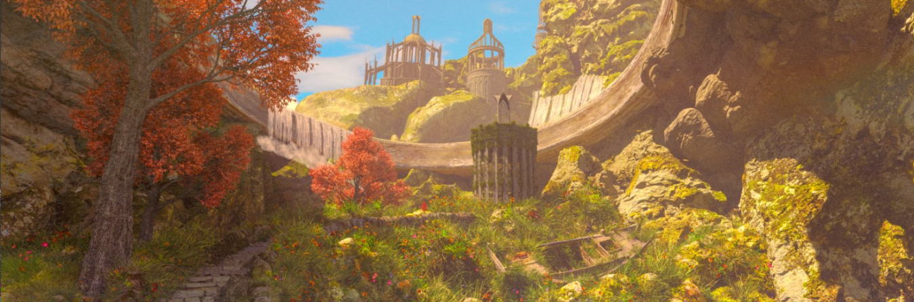

### HakubiSual

VJ operator · 3D & motion designer · I build the tools that run the show.

<a href="https://x.com/HakubiSual">X</a> · <a href="https://acard.dev">Acard</a>

---

### Projects

| | |
|---|---|
| **[Acard](https://acard.dev)** | AI writes markdown, people read refined, Notion-like pages. Connect any agent with one MCP line. |
| **[pase-omo](https://github.com/Hakubisual/pase-omo)** | Agent workflow UI for Paseo - DAG graphs, live todo cards, approvals, mobile-ready. |
| **[rhwp-plus](https://github.com/Hakubisual/rhwp-plus)** | HWP/HWPX engine based on rhwp - Markdown import, MCP tool for agents. |
| **[notebase](https://github.com/Hakubisual/notebase)** | Project status, wiki pages and databases for your notes. |

### Stage work

Realtime visuals with TouchDesigner, Notch, Unreal and Resolume, plus in-house FFGL plugins (C++ · GLSL) when a show needs something the tools can't do.
